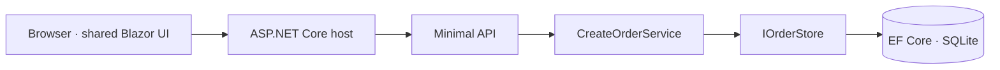
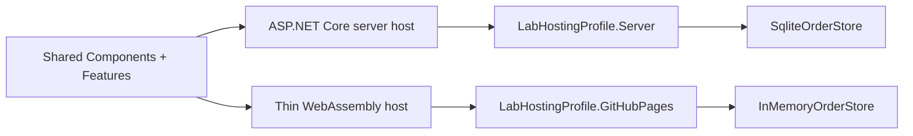

# .NET Code Maturity Lab technical guide

This document is the technical authority for the repository. It describes the architecture, runtime profiles, configuration, routes, persistence, localization, progress model, AI boundary, verification, and GitHub Pages deployment.

<details>
<summary><strong>Resumen técnico en español</strong></summary>

El repositorio mantiene una sola experiencia educativa y dos hosts delgados. La aplicación ASP.NET Core registra SQLite y endpoints reales; el host estático de GitHub Pages registra memoria temporal y publica los mismos componentes como Blazor WebAssembly. Las diferencias se seleccionan en la composición de dependencias, no duplicando las páginas o reglas del laboratorio.

`README.md` presenta el proyecto para revisión de portafolio. Este archivo concentra las decisiones y comandos de desarrollo.

</details>

## Architecture





The two project files exist because ASP.NET Core interactive server rendering and a static WebAssembly artifact use different SDKs and startup models. They do not represent two independently maintained applications:

- `DotnetCodeMaturityLab.csproj` owns the server host, Minimal API, EF Core, and SQLite.
- `GitHubPages/DotnetCodeMaturityLab.GitHubPages.csproj` is a thin static host. It links the shared components, learning content, styles, images, domain service, and contracts from the repository root.
- `LabHostingProfile` describes visible runtime capabilities.
- `IOrderStore` selects durable SQLite persistence or browser-session memory through dependency injection.
- `IAiOrderSuggestionService` keeps the AI boundary replaceable; the published Junior stage registers the deterministic local provider.

Do not add runtime checks throughout the UI when a difference can be represented by one profile or dependency registration.

## Runtime configuration

### ASP.NET Core profile

`Program.cs` registers interactive server components, `SqliteOrderStore`, `CreateOrderService`, the deterministic AI service, `LabHostingProfile.Server`, and the Minimal API endpoints.

`appsettings.json` contains the local connection string:

```json
{
  "ConnectionStrings": {
    "Orders": "Data Source=App_Data/orders.db"
  }
}
```

The startup code resolves a relative SQLite data source against the application content root, stores data-protection keys under `App_Data/keys`, and creates the educational database when it does not exist.

### GitHub Pages profile

`GitHubPages/Program.cs` registers the shared root app and pages, `InMemoryOrderStore`, the same domain service and deterministic AI provider, and `LabHostingProfile.GitHubPages`.

GitHub Pages cannot execute .NET server endpoints or SQLite. The UI therefore labels its request and persistence flow as a simulation and never claims to contact an external AI provider.

## Commands

Run the server application:

```powershell
./start-local.ps1
```

Equivalent SDK command:

```powershell
dotnet run --project DotnetCodeMaturityLab.csproj
```

Run the static host locally:

```powershell
dotnet run --project GitHubPages/DotnetCodeMaturityLab.GitHubPages.csproj
```

Restore, build, and test:

```powershell
dotnet restore DotnetCodeMaturityLab.slnx
dotnet build DotnetCodeMaturityLab.slnx -c Release --no-restore
dotnet test tests/DotnetCodeMaturityLab.Tests/DotnetCodeMaturityLab.Tests.csproj -c Release --no-restore
```

Build the validated Pages artifact:

```powershell
./build-github-pages.ps1
```

The script publishes into `artifacts/github-pages.staging`, verifies the required static files and deep-route fallback, injects the repository base path, and replaces `artifacts/github-pages` only after validation succeeds.

## Routes and GitHub Pages deep links

`Features/Navigation/AppRoutes.cs` is the canonical route source. Generated links intentionally omit a leading slash so Blazor preserves the configured repository base path.

Public lesson routes are English-first, for example:

```text
learn/junior/csharp-fundamentals
learn/junior/methods-and-classes
learn/junior/ai-and-llms
```

The curriculum still uses stable internal slugs inherited from the original Spanish content. `AppRoutes` maps between internal identifiers and public canonical paths so route concerns do not leak into lesson data.

GitHub Pages serves `404.html` before Blazor can handle a direct deep link. The fallback encodes the requested route into the query string and redirects to the repository root; the startup page restores the original route before the router initializes.

When adding a route:

1. Add or update the canonical value in `AppRoutes`.
2. Use `AppRoutes` from components instead of hard-coded absolute paths.
3. Extend route contract tests for canonical and supported legacy paths.
4. Verify direct navigation and browser refresh in the Pages artifact.

## Localization

English is the default language. `AppLanguageState` owns the current language and shared interface labels. Page-specific copy uses one component and one content model with English and Spanish values.

The browser stores the language under `dotnet-code-maturity-lab-language`. `wwwroot/lab-progress.js` also updates the document `lang` attribute. New visible copy must provide both languages and must not introduce a second language-specific route tree.

## Learning content and progress

- `LearningContracts` contains neutral records such as `LessonCodePane`, `LessonPerspective`, `ModuleLesson`, and `InterviewQuestion`. Shared rendering must depend on these contracts, never on types named after a seniority level.
- `LearningLevelCatalog` is the bilingual source of truth for level order, availability, module maps, goals, and laboratory metadata.
- `LearningContentCatalog`, `InterviewContentCatalog`, and `LaboratoryContentCatalog` resolve a level-specific provider behind the shared course, interview, and laboratory pages.
- `JuniorCurriculum`, `JuniorLessonCatalog`, `JuniorModuleMetadataCatalog`, and `JuniorInterviewCatalog` remain intentionally level-specific because they own Junior content rather than reusable presentation.
- `JuniorLaboratory` is the executable Junior capstone selected by the neutral laboratory catalog.

Progress is stored in browser `localStorage` under the `LearningProgress` versioned contract. Entries are namespaced by level (`junior:fundamentos-csharp`, later `middle:solid`) so catalogs cannot overwrite one another. Version 4 migrates existing unqualified Junior entries in place while retaining the original storage key. The current model distinguishes:

- `viewed`: the learner opened the content;
- `reviewed`: the learner reached the final perspective;
- `completed`: the learner explicitly confirmed the module after reviewing its fifth perspective.

Capstone completion is separate: the Junior laboratory records completion only after one successful request and one controlled validation failure provide observable evidence.

When the progress contract changes, preserve user history and document why a migration upgrades or downgrades a state.

### Adding a maturity level

1. Register its bilingual module map in `LearningLevelCatalog` while leaving `IsAvailable` false.
2. Add its curriculum, lesson, metadata, and interview catalogs using the neutral contracts.
3. Register providers in `LearningContentCatalog`, `InterviewContentCatalog`, and `LaboratoryContentCatalog`.
4. Add its internal-to-canonical module slugs to `AppRoutes` and use `LearnModule(level, slug)` from UI code.
5. Run shared content, route, progress migration, responsive, server-host, and GitHub Pages checks.
6. Mark the level available only after its learning path, interview, and capstone are complete.

The approved visual hierarchy is invariant across Junior, Middle, and Senior. Seniority is communicated by module content, engineering decisions, interview depth, and laboratory behavior—not by duplicating or redesigning the player.

## Order API and persistence

The server maps:

```text
POST /api/orders
GET  /api/orders
GET  /api/orders/{id:guid}
```

`CreateOrderService` validates the request before constructing and storing an `Order`. `OrderEndpoints` translates the application result into `201 Created` or validation problems. `SqliteOrderStore` creates a short-lived `OrderDbContext` per operation and uses no-tracking reads.

The laboratory verifies observable behavior rather than private methods:

- a valid request produces an identifier, subtotal, and stored order;
- an invalid request produces validation errors and does not change persistence;
- deliberate delays expose each educational stage; they do not represent actual network latency.

## AI boundary

The Junior AI module demonstrates a replaceable integration boundary, not a live model call.

`SimulatedAiOrderSuggestionService` is deterministic so tests and the Pages demo can reproduce minimum-context input, a constrained category allowlist, validation and fallback, rejection of instructions that attempt to override the application contract, and mandatory human review.

No secret, customer note, or prompt is sent outside the process. A real provider must be implemented behind `IAiOrderSuggestionService`, configured only in a server host, and protected with secret management, timeouts, budget controls, logging rules, and output validation.

## Automated verification

The test project covers thirteen lesson routes, sixty-five bilingual perspectives, fourteen bilingual interview questions, code formatting and curriculum contracts, order rules, SQLite persistence, HTTP integration behavior, AI fallback, and Pages routing contracts.

Run:

```powershell
dotnet test tests/DotnetCodeMaturityLab.Tests/DotnetCodeMaturityLab.Tests.csproj -c Release
```

### VSTest host troubleshooting

If `vstest.console` cannot connect to `testhost` before its timeout, the run is **aborted**, not successful. Do not report it as green.

Capture diagnostic output before changing code:

```powershell
dotnet test tests/DotnetCodeMaturityLab.Tests/DotnetCodeMaturityLab.Tests.csproj -c Release --diag artifacts/vstest.log
```

Check for orphaned `dotnet`, `testhost`, or `vstest.console` processes from an earlier aborted run and confirm the installed .NET 10 SDK with `dotnet --info`. `VSTEST_CONNECTION_TIMEOUT` may extend startup time, but it is not a substitute for diagnosing a host that never connects. The GitHub Actions test job remains the release gate for Pages deployment.

## GitHub Pages deployment

`.github/workflows/deploy-pages.yml` runs on pushes to `main` and manual dispatches from `main`. It restores the solution, runs the Release test suite, builds and validates the static artifact, uploads `artifacts/github-pages/wwwroot`, and deploys to the `github-pages` environment.

Repository settings must use **Settings → Pages → Source: GitHub Actions**. Editable source remains in `main`; generated deployment output is not a development branch.

### SEO and social preview contract

`Features/Seo/SiteSeo.cs` is the semantic source of truth for the public title, description, canonical URL, and social image used by the server host. The static Pages document repeats those literal values because crawlers and link unfurlers do not execute Blazor; automated contract tests keep both hosts aligned.

The public preview is `wwwroot/images/dotnet-code-maturity-lab-social.jpg` at 1200 × 630 pixels. `robots.txt`, `sitemap.xml`, and `site.webmanifest` are shared assets and must be linked into the static host project. `build-github-pages.ps1` rejects an artifact if any required discovery file or large social-card metadata is missing.

## Code documentation standard

Comments are required when code contains behavior a reviewer cannot safely infer from syntax alone. Prefer comments that explain intent, constraints, compatibility, or a non-obvious state transition.

Document public safety boundaries, progress migrations, compatibility mappings, simulated timing, Pages route recovery, browser observers and throttling, and deployment safeguards. Do not narrate straightforward validation, property assignment, or standard framework calls. Update a comment when the protected decision changes.

## Repository structure

```text
Components/              Shared layout, learning pages, interview, and laboratory UI
Features/AI/             Replaceable AI contract and deterministic Junior provider
Features/Configuration/  Public site identity and links
Features/Learning/       Shared contracts and registries plus level-specific bilingual catalogs
Features/Localization/   Language state and localized values
Features/Navigation/     Canonical route generation and compatibility mapping
Features/Orders/         Domain, service, stores, EF Core, and Minimal API endpoints
GitHubPages/             Thin static WebAssembly host and deep-link fallback
tests/                   Unit, content, route, persistence, AI, and HTTP integration tests
docs/references/         Owner-supplied planning references; not implementation authority
wwwroot/                 Shared styles, scripts, images, and browser storage adapters
```

## Scope and security boundaries

This is an educational portfolio repository. The local server is not presented as a production deployment. Before exposing equivalent functionality publicly, add authentication and authorization, migrations, managed secrets, structured observability, abuse and budget controls, a privacy policy, and operational ownership.

Middle and Senior remain intentionally unavailable until their code, laboratories, interview content, responsive QA, and automated verification exist.
