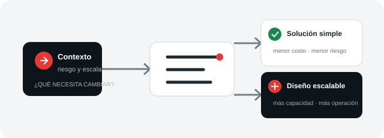

<div align="center">

# .NET Code Maturity Lab

**A bilingual, visual learning laboratory for understanding and defending practical .NET engineering decisions.**

`.NET 10` · `Blazor` · `ASP.NET Core` · `EF Core` · `SQLite` · `xUnit`

[Live demo](https://alfonso-13.github.io/dotnet-code-maturity-lab/) · [Technical guide](DEV.md) · [MIT license](LICENSE)

</div>

---

## About the project

.NET Code Maturity Lab shows how one order-processing solution grows from C# fundamentals into a complete Junior application. Instead of presenting isolated syntax, it connects language features, design intent, tests, persistence, HTTP, and safe LLM boundaries through one domain.

The first portfolio stage contains thirteen modules, sixty-five code-first perspectives, a fourteen-question interview simulator, and one integrative laboratory. English is the default interface language; Spanish can be selected without duplicating the rendering model.


<details>
<summary><strong>Resumen en español</strong></summary>

.NET Code Maturity Lab es un laboratorio visual bilingüe para estudiar y defender decisiones prácticas de ingeniería .NET. La primera etapa conecta trece módulos Junior, sesenta y cinco perspectivas, catorce preguntas de entrevista y un laboratorio integrador de órdenes con persistencia, HTTP y un caso seguro de asistencia mediante LLM.

La aplicación local ejecuta ASP.NET Core, EF Core y SQLite. La demo pública de GitHub Pages comparte la misma interfaz y reglas, pero usa memoria temporal y una simulación determinista; nunca afirma disponer de una API, base de datos o proveedor de IA externos.

</details>

## Interactive demo

[Open the .NET Code Maturity Lab](https://alfonso-13.github.io/dotnet-code-maturity-lab/)

The public build lets reviewers explore the complete Junior learning path, interview simulator, history and ecosystem guides, and laboratory flow without credentials or a server process.

| Profile | Runtime | Persistence | Intended use |
| --- | --- | --- | --- |
| Local application | ASP.NET Core interactive server | EF Core + SQLite | Execute real endpoints, persistence, and HTTP integration tests. |
| GitHub Pages | Static Blazor WebAssembly host | Browser-session memory | Review the portfolio experience through an explicitly labeled simulation. |

The static host links the shared components and domain code instead of maintaining a second learning interface. Runtime differences are selected at the composition boundary through `IOrderStore` and `LabHostingProfile` registrations.

## Junior stage

The order-processing domain connects all thirteen modules:

1. C# fundamentals: data, decisions, and repetition.
2. Methods, constructors, and properties.
3. Value and reference types, class, struct, record, enum, and interface.
4. Object-oriented programming and its pillars.
5. Validation, results, and exceptions.
6. Collections, generics, and complexity.
7. LINQ and lambda expressions.
8. `Task`, `Task<T>`, `ValueTask`, `async`, and `await`.
9. Unit tests, HTTP integration tests, and AAA.
10. REST, DTOs, routes, methods, and common HTTP status codes.
11. Relational persistence with SQL and Entity Framework Core.
12. ASP.NET Core composition, middleware, configuration, and dependency injection.
13. Generative AI and LLM fundamentals: server boundaries, secrets, minimum context, output validation, fallback, and human review.

Every module uses five perspectives with copyable C# examples, contextual hints, navigation, and explicit viewed, reviewed, and completed progress.

## Engineering highlights

- One shared bilingual component model with English-first canonical routes.
- Thin server and static hosts that select persistence and runtime capabilities through dependency injection.
- EF Core and SQLite persistence behind an `IOrderStore` contract.
- Real Minimal API endpoints with unit, persistence, route-contract, and HTTP integration coverage.
- Deterministic LLM simulation that demonstrates validation, fallback, prompt-boundary protection, and human review without sending data externally.
- Browser-local learning progress with an explicit versioned migration.
- GitHub Pages deep-link recovery and repository base-path handling.
- Automated Pages workflow that tests, builds, validates, and deploys only from `main`.

## Visual learning model

| Compare | Experiment | Decide |
| --- | --- | --- |
|  |  |  |

The application also includes a maturity roadmap, a visual .NET history timeline, and an ecosystem guide covering ASP.NET Core, Blazor, Razor Pages, MVC, .NET MAUI, WPF, EF Core, SignalR, and gRPC.

## Run locally

Requirement: .NET 10 SDK.

```powershell
git clone https://github.com/Alfonso-13/dotnet-code-maturity-lab.git
cd dotnet-code-maturity-lab
./start-local.ps1
```

Alternatively:

```powershell
dotnet run --project DotnetCodeMaturityLab.csproj
```

The server profile creates `App_Data/orders.db`. Local database files, build output, and deployment artifacts are ignored by Git.

Run the automated suite and build the static artifact with:

```powershell
dotnet test tests/DotnetCodeMaturityLab.Tests/DotnetCodeMaturityLab.Tests.csproj -c Release
./build-github-pages.ps1
```

Architecture, configuration, route behavior, verification, troubleshooting, and deployment are documented in [DEV.md](DEV.md).

## Scope and reuse

This repository is an educational portfolio project, not a hosted production learning platform or a public AI service. The Pages build does not execute ASP.NET Core endpoints, SQLite, or an external model. A real public service would additionally require authentication, authorization, global abuse and budget controls, observability, migrations, secret management, and an explicit privacy policy.

Middle and Senior are intentionally marked **Coming soon** until their learning paths, laboratories, and interview questions are implemented and verified.

## License

Available under the [MIT License](LICENSE).
