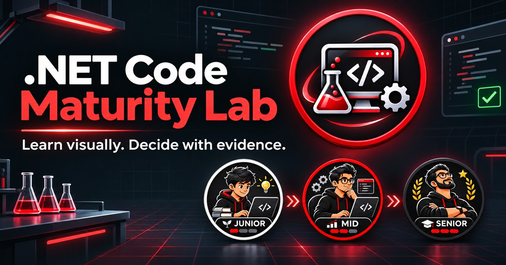
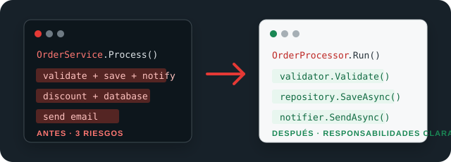
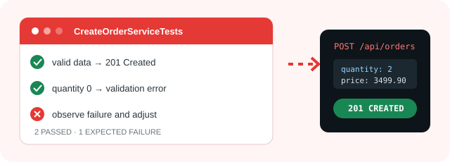

<div align="center">

# .NET Code Maturity Lab

**A bilingual, visual learning laboratory for understanding and defending practical .NET engineering decisions.**

`.NET 10` · `Blazor` · `ASP.NET Core` · `EF Core` · `SQLite` · `xUnit`

[Live demo](https://alfonso-13.github.io/dotnet-code-maturity-lab/) · [Technical guide](DEV.md) · [MIT license](LICENSE)

</div>

---

[](https://alfonso-13.github.io/dotnet-code-maturity-lab/)

## About the project

.NET Code Maturity Lab shows how one order-processing solution grows from C# fundamentals into a complete Junior application and then evolves through Middle-level design decisions. Instead of presenting isolated syntax, it connects language features, design intent, tests, persistence, HTTP, maintainability, and safe LLM boundaries through one domain.

The available portfolio stages contain twenty-three bilingual modules, 115 code-first perspectives per language, thirty interview decisions, and two integrative laboratories. English is the default interface language; Spanish can be selected without duplicating the rendering model.


<details>
<summary><strong>Resumen en español</strong></summary>

.NET Code Maturity Lab es un laboratorio visual bilingüe para estudiar y defender decisiones prácticas de ingeniería .NET. Las etapas disponibles conectan trece módulos Junior y diez Middle, 115 perspectivas por idioma, treinta decisiones de entrevista y dos laboratorios integradores con persistencia, HTTP, diseño mantenible y límites seguros para LLM.

La aplicación local ejecuta ASP.NET Core, EF Core y SQLite. La demo pública de GitHub Pages comparte la misma interfaz y reglas, pero usa memoria temporal y una simulación determinista; nunca afirma disponer de una API, base de datos o proveedor de IA externos.

</details>

## Interactive demo

[Open the .NET Code Maturity Lab](https://alfonso-13.github.io/dotnet-code-maturity-lab/)

The public build lets reviewers explore the complete Junior and Middle learning paths, interview simulators, history and ecosystem guides, and laboratory flows without credentials or a server process.

| Profile | Runtime | Persistence | Intended use |
| --- | --- | --- | --- |
| Local application | ASP.NET Core interactive server | EF Core + SQLite | Execute real endpoints and persistence. AI is deterministic by default or Gemini when configured with a server-side key. |
| GitHub Pages | Static Blazor WebAssembly host | Browser-session memory | Explore an explicitly labeled HTTP, persistence, and AI simulation; no external key or server is used. |

The static host links the shared components and domain code instead of maintaining a second learning interface. Runtime differences are selected at the composition boundary through `IOrderStore` and `LabHostingProfile` registrations.

## Junior stage

The order-processing domain connects all thirteen modules:

1. C# fundamentals: data, decisions, and repetition.
2. Methods, constructors, and properties.
3. Value and reference types, class, struct, record, enum, and interface.
4. Object-oriented programming and its pillars.
5. Validation, results, and exceptions.
6. Collections, generics, and complexity.
7. LINQ and lambda expressions.
8. `Task`, `Task<T>`, `ValueTask`, `async`, and `await`.
9. Unit tests, HTTP integration tests, and AAA.
10. REST, DTOs, routes, methods, and common HTTP status codes.
11. Relational persistence with SQL and Entity Framework Core.
12. ASP.NET Core composition, middleware, configuration, and dependency injection.
13. Generative AI and LLM fundamentals: server boundaries, secrets, minimum context, output validation, fallback, and human review.

Every module uses five perspectives with copyable C# examples, contextual hints, navigation, and explicit viewed, reviewed, and completed progress. The interview simulator adds boxing/unboxing and `IEnumerable` versus `IQueryable` questions with corresponding examples in the memory and LINQ lessons.

## Middle stage

Ten modules reuse the same learning player while shifting the evidence from syntax to maintainable design: applied SOLID, dependency injection, strategy and composition, safe refactoring, EF Core query and index behavior, ProblemDetails, JWT claims and policy authorization, HTTP integration, pragmatic architecture boundaries, and maintainable AI integration. The stage includes 50 bilingual perspectives, fourteen interview decisions, and a capstone that checks architecture choices, the implemented HTTP/persistence flow, and the configured AI boundary. A separately labeled timeout simulation shows the safe AI fallback. JWT policy, 409 conflict handling, and EF migrations are educational examples, not behaviors claimed by the current local API.

## Engineering highlights

- One shared bilingual component model with English-first canonical routes.
- One visual course, interview, and laboratory shell for every seniority level; catalogs change the content without duplicating the design.
- Thin server and static hosts that select persistence and runtime capabilities through dependency injection.
- EF Core and SQLite persistence behind an `IOrderStore` contract.
- Real Minimal API endpoints with unit, persistence, route-contract, and HTTP integration coverage.
- Configurable server-only Gemini adapter with constrained output, timeout fallback, and human review. The default and Pages AI adapter is visibly labeled as deterministic simulation.
- Browser-local learning progress namespaced by level, with an explicit migration that preserves existing Junior history.
- GitHub Pages deep-link recovery and repository base-path handling.
- Automated Pages workflow that tests, builds, validates, and deploys only from `main`.

## Visual learning model

| Compare | Experiment | Decide |
| --- | --- | --- |
|  |  |  |

The application also includes a maturity roadmap, a visual .NET history timeline, and an ecosystem guide covering ASP.NET Core, Blazor, Razor Pages, MVC, .NET MAUI, WPF, EF Core, SignalR, and gRPC.

## Run locally

Requirement: .NET 10 SDK.

```powershell
git clone https://github.com/Alfonso-13/dotnet-code-maturity-lab.git
cd dotnet-code-maturity-lab
./start-local.ps1
```

Alternatively:

```powershell
dotnet run --project DotnetCodeMaturityLab.csproj
```

The server profile creates `App_Data/orders.db`. Local database files, build output, and deployment artifacts are ignored by Git.

To use a real AI provider in the local server, set `AI__Provider=Gemini` and `AI__ApiKey` in the server process environment before running `start-local.cmd` or `start-local.ps1`. Without those settings, AI is visibly labeled as a deterministic simulation. GitHub Pages always uses the simulation and never receives a provider key. See [DEV.md](DEV.md) for the configuration contract and limits.

Run the automated suite and build the static artifact with:

```powershell
dotnet test tests/DotnetCodeMaturityLab.Tests/DotnetCodeMaturityLab.Tests.csproj -c Release
./build-github-pages.ps1
```

Architecture, configuration, route behavior, verification, troubleshooting, and deployment are documented in [DEV.md](DEV.md). Future Senior, architecture, and advanced AI curriculum candidates are kept separately in [TODO.md](TODO.md) so planned work is not confused with available functionality.

## Scope and reuse

This repository is an educational portfolio project, not a hosted production learning platform or a public AI service. The Pages build does not execute ASP.NET Core endpoints, SQLite, or an external model. A real public service would additionally require authentication, authorization, global abuse and budget controls, observability, migrations, secret management, and an explicit privacy policy.

Junior and Middle are available. Senior remains intentionally marked **Coming soon** until its learning path, laboratory, and interview questions are implemented and verified.

## License

Available under the [MIT License](LICENSE).
