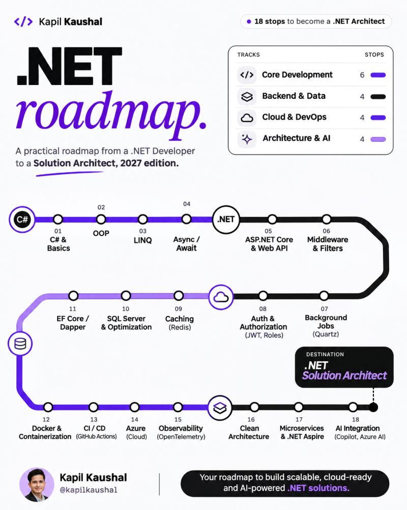
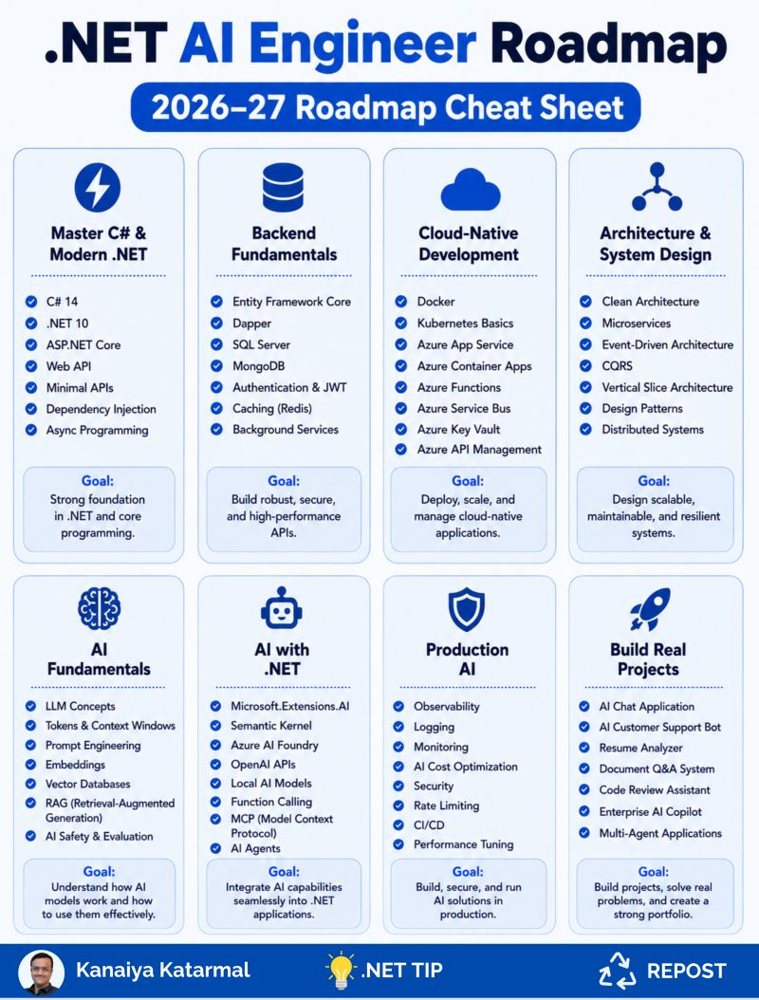
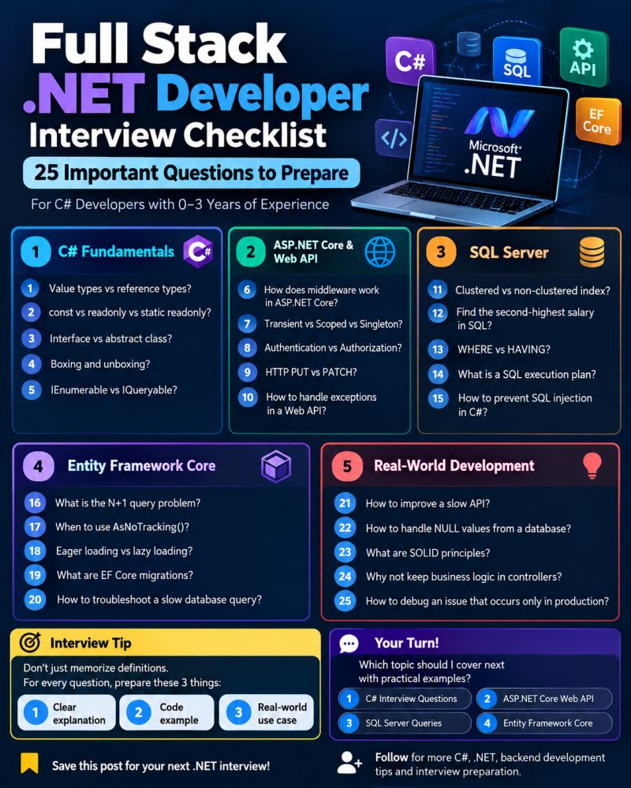

# Product backlog

This file records future portfolio stages that are intentionally outside the completed Junior and Middle releases. Items remain proposals until their technical claims, package choices, and learning outcomes are validated against current primary documentation.

## Middle and Senior

- Middle expanded release completed: ten bilingual modules, 50 perspectives per language, fourteen interview decisions, one capstone laboratory, level-scoped progress, and shared responsive UI are registered and available.
- Keep Middle content current through evidence-backed corrections; add new topics only when they deepen maintainability decisions instead of duplicating Junior syntax coverage.
- Complete the bilingual Senior learning path, laboratory, and interview simulator before marking the level available.
- Preserve one shared UI and domain model; runtime capabilities must continue to be selected through configuration and dependency injection.

## Cross-cutting AI evolution

Junior already teaches the safe baseline: server-side secrets, minimum context, constrained output, fallback, and human review. Later levels should deepen that boundary instead of duplicating the Junior module.

### Middle candidate outcomes

- Re-evaluate `Microsoft.Extensions.AI`, Semantic Kernel / Agent Framework, Microsoft Foundry, OpenAI-compatible APIs, and local models when a second real provider, hosted profile, or multistep workflow exists. The current single-call decision and source links are recorded in DEV.md; no dependency is needed for this release.
- Add embeddings, vector search, retrieval-augmented generation, function calling, and evaluation only for a sourced knowledge task with measurable retrieval and privacy requirements. The current short order note does not justify them.
- Provider fakes, caller cancellation, provider timeout fallback, and an explicitly simulated timeout in the Middle laboratory are covered. The simulation does not claim that a real provider outage occurred.

### Senior and architecture candidate outcomes

- Operate AI workloads with observability, privacy-safe logging, security controls, rate limits, budgets, performance measurements, and CI/CD evaluation gates.
- Compare tool calling, MCP, agents, and multi-agent orchestration only where they solve a demonstrated problem; avoid presenting orchestration complexity as a default.
- Cover cloud-native deployment, managed identity and secret storage, failure isolation, model/provider portability, and cost-aware routing.
- Build a portfolio-grade AI case whose behavior remains understandable and testable without requiring visitors to provide credentials.

## Interview simulator expansion

Before adding questions, compare each candidate against the existing Junior catalog to prevent duplicate prompts. Middle and Senior questions must evaluate reasoning through a clear explanation, a code or query example, and a realistic use case rather than memorized definitions.

### Candidate topic groups

- C# and runtime: `const` vs `readonly` vs `static readonly`, interface vs abstract class, boxing and unboxing, and `IEnumerable` vs `IQueryable`.
- ASP.NET Core and Web API: middleware execution, DI lifetimes, authentication vs authorization, PUT vs PATCH, and centralized exception handling.
- SQL Server: clustered vs non-clustered indexes, second-highest-value queries, `WHERE` vs `HAVING`, execution plans, and SQL injection prevention.
- Entity Framework Core: N+1 queries, `AsNoTracking`, eager vs lazy loading, migrations, and diagnosing slow database queries.
- Real-world engineering: slow API diagnosis, nullable database values, SOLID application, business logic boundaries, and production-only incident debugging.

These groups are curriculum candidates, not a commitment to exactly 25 questions. The review for this release found: boxing/unboxing and `IEnumerable` versus `IQueryable` belong to Junior and now have lesson evidence and interview questions; DI lifetimes, middleware, JWT/401/403, `AsNoTracking`, query shape, and HTTP integration are already covered in Middle lessons and questions. SQL Server-specific index taxonomy and second-highest-salary puzzles do not match this SQLite order flow. Slow production API diagnosis and incident debugging belong to Senior. Add a future prompt only when a corresponding lesson and observable example exist.

## Reference material

This roadmap was supplied by the project owner on 2026-11-23 to guide the later Architecture stage after Middle and Senior. It is preserved as planning input, not implementation authority. Its Core Development, Backend and Data, Cloud and DevOps, and Architecture and AI tracks must be reconciled with the existing curriculum and verified against current primary documentation before becoming modules.

The image above was supplied by the project owner on 2026-11-19 as planning inspiration. It is preserved for later curriculum analysis, not treated as an authoritative source. Attribution visible in the original image remains intact; every topic and version must be verified before implementation.

This interview checklist was supplied by the project owner on 2026-11-19. It is retained to compare future Middle and Senior interview coverage. The visible attribution remains intact; question wording and technical answers must be reviewed against current Microsoft and database documentation before use.

### Reference reconciliation · 2026-11-23

The three owner-supplied references overlap, but they describe different destinations. They are mapped to the product stages below so future work deepens the existing order flow instead of duplicating topics or moving production concerns into Junior.

| Reference topic family | Current placement | Decision |
| --- | --- | --- |
| C#, OOP, LINQ, async/await, HTTP, middleware, basic authentication/authorization, EF Core foundations | Junior | Covered by the thirteen-module foundation. Boxing/unboxing and `IEnumerable` versus `IQueryable` interview prompts now have matching lesson examples. |
| SOLID, dependency lifetimes, Strategy, safe refactoring, EF Core query shape, ProblemDetails, JWT policy authorization, integration testing, application boundaries | Middle | Covered by the ten-module maintainability stage and its capstone. |
| JWT validation, claims, roles, policy-based authorization, and 401 versus 403 | Middle | Junior introduces middleware order and authentication versus authorization. Middle teaches bearer-token trust and `orders.write` through code examples and interview reasoning. The running API has no JWT authentication or 401/403 policy flow yet. |
| SQL indexes, migrations, generated SQL, query plans, N+1 detection, and database-oriented diagnosis | Middle | The EF Core module teaches projection, tracking, a composite-index migration example, plan inspection, and transaction boundaries. The local database currently uses `EnsureCreated`; migration and index examples are not executed by startup. |
| Caching, background services, performance diagnosis, and operational troubleshooting | Senior candidate | Teach these through measurable production behavior, not isolated API memorization. |
| Docker, CI/CD, Azure, observability, security hardening, rate limits, resilience, messaging, and cost control | Senior | These belong to operating the solution under production constraints. |
| Clean/vertical architecture, CQRS, microservices, event-driven and distributed systems | Architecture | Middle introduces pragmatic dependency boundaries; the later Architecture stage must compare system-level trade-offs without prescribing ceremony. |
| LLM concepts, safe server boundary, minimum context, validated output, fallback, and human review | Junior | Covered as the safe baseline. |
| Provider-independent AI, structured output, timeout/cancellation, fakes, contract tests, and deterministic fallback | Middle | The server can use Gemini with a private key and validated output; Pages and the default server mode remain deterministic simulations. Fake-provider contract tests, cancellation, provider timeout fallback, and a labeled fault scenario in the laboratory are covered. |
| Embeddings, vector search, RAG, function calling, MCP, agents, model evaluation, production security and cost | Senior / Architecture AI | Add only through verified use cases, current primary documentation, and observable operational evidence. |
